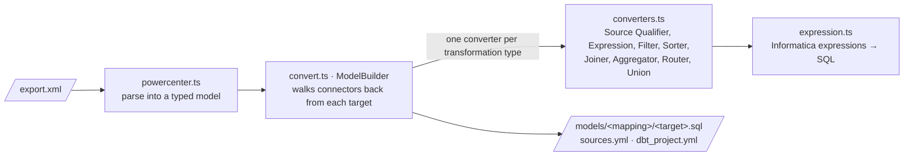

# pwc2dbt: Informatica PowerCenter mapping → dbt models

`pwc2dbt` reads a PowerCenter repository export (XML) and writes a dbt project with **one model per mapping target**. Each transformation becomes one CTE named after it, so every column of the generated SQL can be traced back to the mapping.

The sample export ([`examples/FLOWLINE_DEMO_JAFFLESHOP.xml`](examples/FLOWLINE_DEMO_JAFFLESHOP.xml)) has 3 mappings and 16 targets, and it produces 16 models ([`examples/jaffle_shop_dbt/`](examples/jaffle_shop_dbt/)). All of them run in DuckDB. Wherever the mapping implements the same logic as [dbt-labs/jaffle-shop](https://github.com/dbt-labs/jaffle-shop), the results match it row for row. Where they differ, the mapping itself does something different; each case is listed below.

## How to run

Requires Node.js 22.18 or later. Node runs the TypeScript directly, so there is no build step.

```sh
npm install
npm run convert -- path/to/export.xml --out my_dbt_project   # also: --project <name>, --quiet, --help
npm run convert:example     # regenerate examples/jaffle_shop_dbt from the sample
npm test
npm run bench               # benchmarks
```

The CLI lists each model with its warnings. Targets that cannot be converted are reported on stderr, and the rest are still written. Exit code 0 means everything converted, 1 means some targets failed, and 2 means bad usage or unreadable input.

## How it works



To read the code, start with [`src/convert.ts`](src/convert.ts), which assembles a model. Then read [`src/converters.ts`](src/converters.ts), which has one small class per transformation type, and [`src/expression.ts`](src/expression.ts), the expression translator. [`docs/architecture.md`](docs/architecture.md) has detailed diagrams and a worked example.

## Key decisions, and why

1. **One model per target, one CTE per transformation instance.** The mapping and the SQL can be read side by side. The cost is that upstream logic shared by several targets is repeated in each model. Moving it into shared models is the natural next step once the conversion is trusted.
2. **Convert what the mapping does, not what it was meant to do.** A migration is signed off by reconciling against the legacy output, and silently "fixing" logic would make that impossible. Suspicious wiring is converted as drawn and flagged. That is how four cross-wired targets in the sample were found.
3. **Never emit SQL that quietly means something else.** An unsupported transformation fails its target, with the reason. An expression that cannot be translated becomes `NULL /* UNSUPPORTED */`, with a warning in the model header. A visible gap is cheaper than a wrong number nobody notices.
4. **Parse expressions instead of rewriting text.** `IIF` → `CASE` and operator precedence cannot be done safely with string replacement. Informatica's `NOT`, for example, binds tighter than SQL's.
5. **Take the semantics from the PowerCenter documentation.** A master outer join keeps every *detail* row. Ports are evaluated input, then variable, then output, and a variable keeps the previous row's value. `||` skips NULL operands. `DATE_DIFF` returns elapsed time.
6. **Test equivalence, don't eyeball it.** The XML reimplements dbt-labs/jaffle-shop; its own README says so, and `jaffle_shop_duckdb` has no stores, items, products or supplies. The tests therefore compare against dbt-labs/jaffle-shop, on real data.
7. **DuckDB as the target dialect,** because the reference project runs on it. Dialect-specific SQL is confined to one function table in `expression.ts`.

## What I assumed, and what I chose not to handle

**Assumed:** the decisions above. Beyond those, a table that one mapping loads and another reads is the same dbt model (`ref()`). Sessions, workflows and connections hold scheduling and load settings, so they are out of scope. Every model is a plain select with dbt's default materialization.

**Not handled.** Each of these fails loudly instead of producing SQL:

- **Transformations:** Lookup, Update Strategy, Sequence Generator, Normalizer, Rank, Transaction Control, Stored Procedure, Java and SQL transformations, and mapplets. That target fails.
- **Source Qualifier SQL overrides,** user-defined joins, and several sources in one qualifier. That target fails. A source filter is copied verbatim, with a warning.
- **Stateful variable ports,** meaning a variable that reads the previous row's value, such as a running counter. That port becomes NULL with a warning. In the sample this is `customer_order_number`. Its intent is `row_number() over (partition by customer_id order by ordered_at_day, order_id)`, but making that rewrite is a judgement call left to a person.
- **Expressions:** functions outside the supported set, `DATE_DIFF` in months or years, `TO_CHAR` with a number format, `TRUNC` of a number to a precision, and `IIF` without an else value. That port becomes NULL with a warning.
- **Also not converted:** input-port default values, incremental loads and update strategies, and dbt tests and docs. The targets declare no keys to derive tests from.

## Where the converter is most likely to produce wrong output

These convert without an error but can still differ from PowerCenter:

1. **NULL edge cases.** When *every* operand of `||` is NULL, Informatica returns NULL and `concat()` returns `''`. `DECODE` becomes `CASE … =`, so a NULL never matches a NULL search value. I could not confirm whether PowerCenter matches them.
2. **Types.** No casts are emitted for port data types, so a decimal can come out as a double, with different rounding. `TRUNC` and `TO_CHAR` choose their date or number variant from the argument's port type, and a computed argument whose type is unknown is treated as a number.
3. **Dates and conditions.** Two-digit years (`YY`) follow DuckDB's century rule. A numeric `IIF` or filter condition, which Informatica treats as true when non-zero, is not cast to a boolean.
4. **Aggregator pass-through ports.** A port that is neither grouped nor aggregated returns the last row's value in Informatica, and `any_value()` returns an arbitrary one. This case is warned about.
5. **Logic bugs in the mapping.** Swapped links are flagged. Other bugs, such as the double `/100` below, are reproduced faithfully and without a warning.
6. **Variables.** Local variables are inlined, so a variable used several times is repeated in the SQL. A chain that keeps growing past 100,000 characters is refused, not restructured.
7. **Not run under dbt itself.** There was no Python on the build machine. The tests render the three Jinja calls the converter emits (`source`, `ref`, `var`) and run the result in DuckDB.

**What the comparison found in the sample mapping.** These differences from jaffle-shop come from the mapping, not the converter. Each is pinned down by a test in [`test/jaffle.test.ts`](test/jaffle.test.ts).

| Where | What happens | Why |
|---|---|---|
| `STG_ORDERS`, `STG_PRODUCTS`, `CUSTOMER_360`, `PRODUCT_DAILY_PERFORMANCE` | Columns swapped at the target (cents ↔ dollars, spend ↔ tax ↔ pretax, margin ↔ perishable flag) | Cross-wired connectors in the XML. All four are flagged as *suspicious wiring* |
| `ORDERS` amounts | 100× too small | `EXP_ORDERS_CALC` divides `SUBTOTAL_CENTS` by 100, but because of the swap that column already holds dollars |
| `CUSTOMERS`, `ORDERS` | Customers without orders, and orders without items, are missing | A master outer join keeps every **detail** row, and the side marked master is the one jaffle-shop keeps |
| `is_perishable` | Always 0 | The rule tests `'Y'`/`'1'`; the data holds `'True'`/`'False'` |
| `store_daily_kpis.unique_customers` | Always 0 | `v_PREV_*` is assigned *before* it is compared, so the comparison is always true |
| `customer_order_number` | NULL, with a warning | A running counter (stateful variable port), deliberately not converted |

## Tests

- **Unit and corner-case tests** for the expression translator and for every transformation type, on small synthetic mappings.
- **Equivalence:** the generated SQL runs in DuckDB on a slice of the real jaffle-shop data and is compared row by row with the jaffle-shop models. Every difference has a named test.
- **The CLI end to end,** run as a separate process.
- **Scale and performance:** 10,000 chained transformations, 5,000 columns and 2,000 mappings. Conversion time must grow linearly in every dimension.

To check the tests themselves, I injected 18 realistic bugs one at a time, such as the wrong side of an outer join. The suite caught all of them.

## Working with the coding agent

I built this with Claude Code: Claude Opus 5.5, with a stretch on Claude Sonnet 5.5.

### Process

1. **Understand the input before writing code.** I inventoried the XML with throwaway scripts (transformation types, every function used, the connector graph) and read both jaffle-shop projects.
2. **Decide the shape and the failure policy first:** one model per target, one CTE per transformation, loud failures.
3. **Build in layers,** parser → translator → converter → CLI. I read the generated SQL critically and checked anything odd against the raw XML and the Informatica documentation.
4. **Prove equivalence on real data,** and turn every difference into a named test.
5. **Review and harden.** A code-review pass found 10 bugs. I confirmed each one before fixing it, and every corner case got a test.
6. **Restructure** into one converter class per transformation type, with the equivalence tests as the safety net.
7. **Scale.** I profiled first, then fixed the measured problems: stack depth, quadratic lookups and exponential inlining. Tests lock the fixes in.
8. **Test the tests** with the injected bugs, then document.

### Where the agent got something wrong, and how it was caught

| Mistake | How it was caught |
|---|---|
| Inspecting the XML with text tools: one regex deleted every attribute value, and the parser was configured so that a name filter silently matched nothing | The output was empty or meaningless. Inspecting the parsed structure showed the cause, and the fix went into the real parser |
| Editing source files through shell commands: a blanket rename made a function call itself, and lost backslashes broke two regular expressions | A stack overflow on the next run, and reading the code during the refactor. From then on, only the editor changed source files |
| When cents and dollars came out swapped, the converter was the first suspect | The raw XML showed that the mapping's connectors are cross-wired. That led to the wiring check, which found two more swapped targets |
| Early tests were too weak: the equivalence suite had never been seen to fail, and one test pinned an arbitrary CTE order | A guard test now proves the comparison catches a real difference, and the order test checks the real invariant (dependencies first) |
| A code-review pass found 10 correctness bugs, among them multi-folder output overwriting itself, `SUBSTR` with start 0, `DATE_DIFF` semantics and `\|\|` with NULL | Each was confirmed in DuckDB or the Informatica documentation before fixing, and each now has a test |
| Very long expressions, such as a concatenation of every column for a hash, overflowed the stack | Profiling before writing the scale tests |
| Asked for object-oriented decoupling, the agent planned far more structure than the task needed | I told it not to over-engineer. The result is one converter interface with a class per transformation type |
| A timing test failed when the whole suite ran in parallel | Running the full suite. Timing tests now take the fastest of several runs and run after everything else |
| The bug-injection script reported misleading failure counts | An unmutated baseline and one mutation checked by hand: the verdicts were right, the counting was not |
