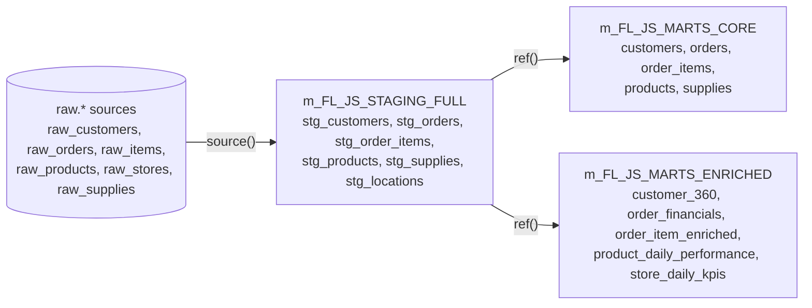
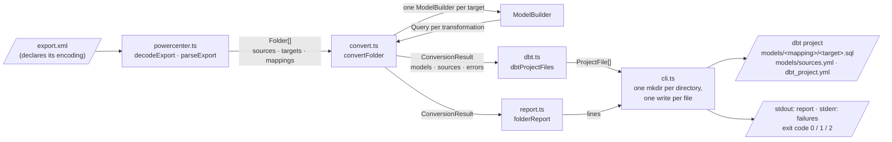
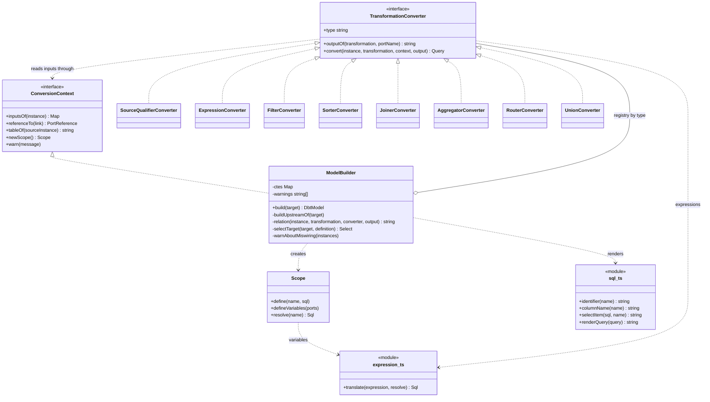
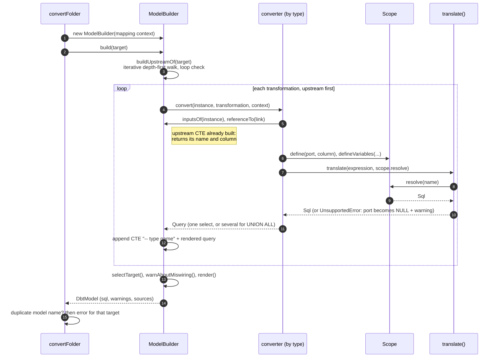
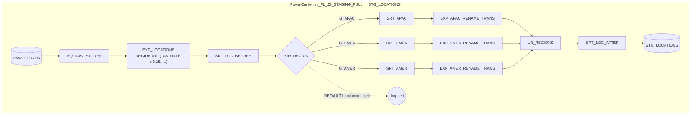
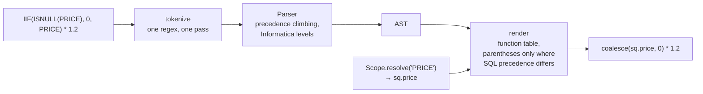
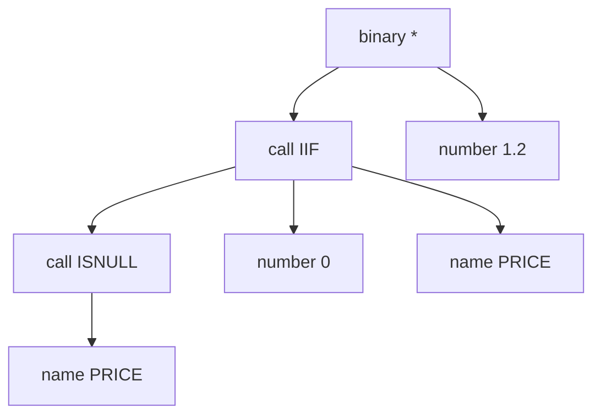
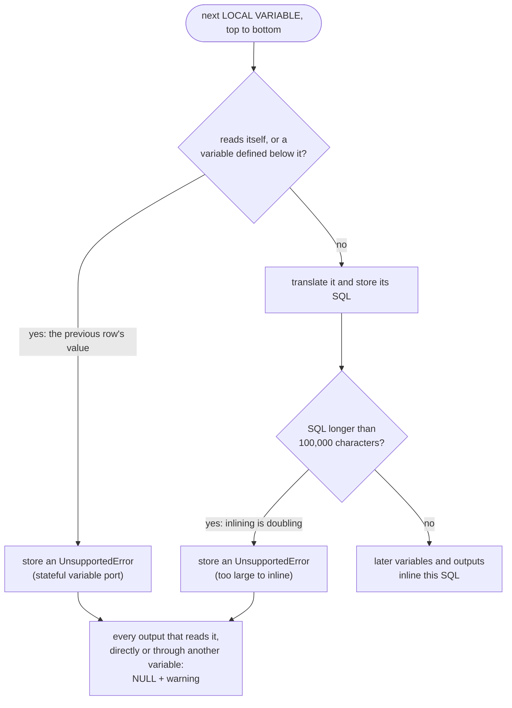

# Architecture

How `pwc2dbt` turns a PowerCenter export into dbt models. The diagrams use the real file, class and CTE names. GitHub renders them; any Mermaid viewer works too.

- [1. What the sample export becomes](#1-what-the-sample-export-becomes)
- [2. Pipeline](#2-pipeline)
- [3. Components](#3-components)
- [4. Building one model](#4-building-one-model)
- [5. From mapping to CTEs: an example](#5-from-mapping-to-ctes-an-example)
- [6. Translating an expression](#6-translating-an-expression)
- [7. Local variables](#7-local-variables)
- [8. Failure policy](#8-failure-policy)
- [9. Performance design](#9-performance-design)

## 1. What the sample export becomes

Each PowerCenter target becomes one dbt model. A table that one mapping loads and another reads becomes a `ref()`, so the three mappings form one dbt DAG.



## 2. Pipeline

The CLI reads the file once and writes each output file once. Everything in between is pure: functions take data and return data.



## 3. Components

The design has one extension point. Each transformation type is a `TransformationConverter` (Strategy pattern), and converters only see the `ConversionContext` interface, never the `ModelBuilder` behind it. Supporting a new type, such as a Lookup, means writing one class and adding it to `defaultConverters`. `test/transformations.test.ts` does exactly that with a stub.



| File | Responsibility |
|---|---|
| `powercenter.ts` | XML → typed model. Indexes for constant-time lookups (`portsByName`, sources by database + name). |
| `convert.ts` | `convertFolder` and `ModelBuilder`: graph walk, CTE order, `source()` vs `ref()`, wiring check. |
| `converters.ts` | One converter class per transformation type, plus the shared helpers they use. |
| `scope.ts` | Names an expression can use: ports, local variables (in PowerCenter's evaluation order), parameters. |
| `expression.ts` | Informatica expression language → DuckDB SQL. |
| `parameters.ts` | `$$PARAM` → `{{ var() }}` with the mapping's default. |
| `sql.ts` | Identifier quoting, select-list items, query rendering. |
| `dbt.ts`, `report.ts`, `cli.ts` | Project files, console report, command line. |
| `errors.ts` | `UnsupportedError`, and `attempt()` to turn one into a value. |

## 4. Building one model

The builder first walks the graph with an explicit stack and builds every CTE upstream first. A converter then always finds its inputs already built, so `referenceTo` returns immediately. The call stack stays shallow however long the chain is: a test converts 10,000 transformations in a row. A loop in the mapping is caught during that walk.



A Router has one output per group. Its groups are built when a consumer first reads them, so only the connected groups get a CTE, named `<router>__<group>`.

## 5. From mapping to CTEs: an example

`STG_LOCATIONS` in the staging mapping routes stores by region, sorts each branch, renames the ports back and unions the branches. Each instance becomes one CTE with the same name:



The generated model, [`stg_locations.sql`](../examples/jaffle_shop_dbt/models/m_fl_js_staging_full/stg_locations.sql), has one CTE per box, in dependency order:

```sql
with
sq_raw_stores as (...),          -- select ... from {{ source('raw', 'raw_stores') }}
exp_locations as (...),          -- case when tax_rate >= 0.15 then 'EMEA' ... end as region
srt_loc_before as (...),         -- sort order dropped
rtr_region__g_apac as (...),     -- where srt_loc_before.region = 'APAC'
srt_apac as (...),
exp_apac_rename_trans as (...),
rtr_region__g_emea as (...),     -- the EMEA and AMER branches follow the same shape
...
un_regions as (...),             -- select ... from exp_apac_rename_trans union all ...
srt_loc_after as (...)
select ... from srt_loc_after
```

| PowerCenter | SQL |
|---|---|
| Source Qualifier | `select … from {{ source() }}`, or `{{ ref() }}` when another mapping loads the table |
| Expression | select list; local variables inlined |
| Filter | `where` |
| Joiner | Normal → `inner join`; Master Outer → `detail left join master`; Detail Outer → `master left join detail`; Full Outer → `full outer join` |
| Aggregator | `group by` the group-by ports |
| Router | one filtered CTE per connected group; the default group is `not (coalesce(c1, false) or …)` |
| Union | `union all`, ports matched through `FIELDDEPENDENCY` (by position without it) |
| Sorter | pass-through (`distinct` if set): a table or view has no row order |

## 6. Translating an expression

The translator parses before it writes SQL, so precedence is right and rewrites can work on structure rather than text:



The AST for that expression. `IIF(ISNULL(x), y, x)` has the shape of `coalesce(x, y)` (checked structurally), so `x` is written once:



- **Precedence.** Informatica's `NOT` binds tighter than any binary operator; SQL's binds looser. Each rendered fragment carries its precedence, and a child is wrapped only when needed: `NOT A = B` → `(not t.a) = t.b`.
- **Long chains.** `A + B + …` is a left-deep tree. It is rendered by walking its left spine in a loop, and a whole `||` chain becomes one `concat(a, b, c, …)`, so tens of thousands of operands do not recurse. Only absurd nesting (thousands of levels of parentheses) still runs out of stack; that becomes an `UnsupportedError`, not a crash.
- **Types.** A fragment knows whether it is a date, which is how `TRUNC` and `TO_CHAR` pick their date or number variant.

## 7. Local variables

PowerCenter evaluates input ports, then variable ports top to bottom, then output ports, and a variable keeps its value from the previous row. A select has nothing like that, so the scope tells the two cases apart:



## 8. Failure policy

| Situation | Result |
|---|---|
| An expression that cannot be translated (unknown function, stateful variable, …) | That port becomes `NULL /* UNSUPPORTED */`, and the model header says why |
| A transformation type with no converter, a SQL override, a loop, two pipelines into one target | That target is reported as failed; the other targets are still converted |
| Any unexpected error while building one target | Reported as `unexpected …` for that target only |
| Converted as drawn but suspicious (swapped-looking links, ignored Pre/Post SQL, …) | Model written, warning in its header and in the report |
| Not a PowerCenter export, unreadable file, bad option | CLI exits with 2 |

## 9. Performance design

Every step is linear in the size of the input, and `test/performance.test.ts` enforces that: four times the input must take less than eight times as long.

- **Indexes, not scans.** Ports by name, connectors grouped by target instance (built once per mapping, shared by its targets), sources by database and name.
- **No recursion proportional to the input.** The iterative graph walk handles long mappings, and loops handle long operator chains.
- **Bounded output.** The `coalesce` rewrite and the variable size cap keep inlined SQL from growing exponentially.
- **Unread XML stays unparsed.** Sessions, workflows and configs are skipped.
- **Few OS calls.** One read of the export, one `mkdir` per output directory, one write per file.

| Benchmark (`npm run bench`) | Mean |
|---|---|
| Parse the sample export (730 KB) | 28 ms |
| Convert the sample export (16 models) | 9 ms |
| Convert a chain of 1,000 transformations | 7 ms |
| Convert a mapping 1,000 columns wide | 9 ms |
| Convert a folder of 500 mappings | 13 ms |
| Translate a typical expression | 0.01 ms |
| Translate a concatenation of 1,000 columns | 1.2 ms |
